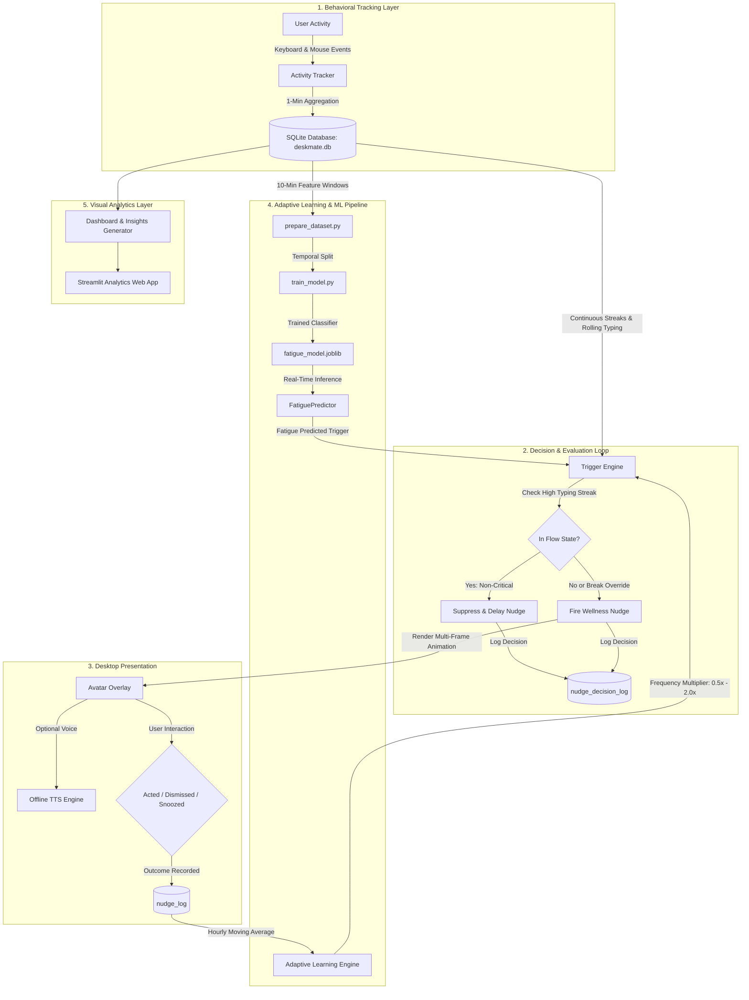

# 🐾 AI DeskMate

> **An adaptive, privacy-first desktop wellness companion that balances sustained productivity and digital ergonomics through behavioral tracking, flow-state awareness, and personalized machine learning.**

AI DeskMate lives unobtrusively in your desktop corner as an animated companion. It observes work patterns—keystroke velocity, mouse movements, active applications, and streak durations—to deliver timely, non-disruptive wellness nudges (water, posture, eye rest, breaks, and fatigue predictions). By respecting deep flow states and dynamically tuning nudge frequency to your personal acceptance rate, AI DeskMate helps you maintain high performance without burnout.

---

## ✨ Features

- **Desktop Corner Companion**: Lightweight, floating overlay featuring 5 procedural multi-frame animated companions (Cat, Dog, Hamster, Human Buddy, Robo-Buddy) with non-activating (`WS_EX_NOACTIVATE`) window styles that never steal keyboard focus.
- **Privacy-First Activity Tracker**: Passive 60-second aggregation of keystroke frequency and mouse events. Keystrokes are counted, never recorded.
- **Flow-State Awareness**: Automatically delays non-critical wellness reminders when typing velocity exceeds continuous focus thresholds, preserving uninterrupted deep work.
- **Break Hard Override**: Enforces essential stretch breaks after 90+ minutes of continuous activity, overriding flow states to protect long-term physical health.
- **Offline Text-to-Speech**: Speech synthesis using system voices (`pyttsx3`) with mute hours and tone customization (Chill, Strict, Cheerful, Sarcastic).
- **Personalized ML Fatigue Prediction**: Chronological feature extraction (10-minute windowing) predicting fatigue levels (`low_fatigue`, `medium_fatigue`, `high_fatigue`) from raw behavioral signals.
- **Closed-Loop Adaptive Frequency**: Dynamically tightens or loosens hourly nudge intervals based on exponential moving averages of your historical acceptance rates.
- **Rich Analytics Dashboard**: Standalone Streamlit dashboard visualizing daily screentime, adherence breakdowns, activity-energy heatmaps, and hourly effectiveness.
- **Auto-Generated Template Insights**: Pure-pandas insight generator delivering actionable wellness recommendations with strict minimum-data guards.
- **Production-Grade Resilience**: Atomic heartbeats, single-instance process lockfile, sleep/wake gap handling, 3-minute post-resume grace period, and SQLite database lock retries.
- **Demo Mode**: Built-in 4-week synthetic dataset and pre-trained demonstration model with sample nudge triggers for presentations and screen captures.

---

## 🏗️ Architecture



---

## 🚀 Installation & Getting Started

### Method 1: Windows Installer (Recommended)
1. Download `AI-DeskMate-Setup-1.0.0.exe` from the Releases page.
2. Run the installer (requires no pre-installed Python).
3. Optionally select **"Start AI DeskMate when I sign in"**.
4. Launch AI DeskMate from the Start Menu or Desktop shortcut.

### Method 2: Running from Source

#### Prerequisites
- Python 3.10 or higher
- Git

```bash
# 1. Clone repository
git clone https://github.com/example/ai-deskmate.git
cd ai-deskmate

# 2. Create and activate virtual environment
python -m venv .venv
# Windows:
.venv\Scripts\activate
# macOS/Linux:
source .venv/bin/activate

# 3. Install dependencies
pip install -r requirements.txt

# 4. Launch the application
python -m app.main
```

---

## 🐣 First-Run Walkthrough

1. **Onboarding Wizard**: On initial launch, AI DeskMate greets you with the setup wizard.
2. **Choose Companion**: Select from Cat, Dog, Hamster, Human Buddy, or Robo-Buddy.
3. **Personalize**: Name your avatar and enter your name (or use the *Surprise Me!* randomizer).
4. **Choose Personality Tone**:
   - **Chill & Gentle**: Calm, patient suggestions.
   - **Strict & Disciplined**: Direct, no-nonsense accountability.
   - **Cheerful & Upbeat**: High energy encouragement.
   - **Witty & Sarcastic**: Humorous, clever banter.
5. **Ready!**: Your companion docks quietly in the bottom-right corner of your desktop, ready to assist.

---

## 🧪 Demo Mode

To record product walkthroughs or evaluate the complete analytics pipeline without waiting weeks for real behavioral data to accumulate:

```bash
# Run with demo flag
python -m app.main --demo
# Or via bundled executable:
AIDeskMate.exe --demo
```

- **Isolated Storage**: Uses `demo.db` in your user data directory; never touches your real data.
- **Seeded History**: Generates 4 weeks of realistic typing, energy dips, breaks, and nudge outcomes.
- **Trained Demo Model**: Automatically trains and loads `demo_fatigue_model.joblib`.
- **Sample Nudge Cycling**: Right-click the system tray icon and select **"🎭 Trigger Sample Nudge"** to cycle through all animations and tones on cue.

---

## 📸 Screenshots

| Onboarding Wizard | Desktop Corner Companion |
| :---: | :---: |
|  |  |

| Analytics Dashboard & Insights | Hourly Effectiveness Comparison |
| :---: | :---: |
|  |  |

---

## 🔒 Privacy & Data Ownership

- **Keystrokes Are Counted, Never Recorded**: The activity tracker listens strictly for keypress counts per minute (`keys_per_min`). Key identities, typed text, passwords, and sensitive inputs are **never** captured, inspected, or buffered.
- **100% Local Storage**: All logs (`activity_log`, `energy_log`, `nudge_log`, `nudge_decision_log`) and model files reside exclusively on your local machine in your user application directory:
  - **Windows**: `%APPDATA%\AI DeskMate`
  - **macOS**: `~/Library/Application Support/AI DeskMate`
  - **Linux**: `~/.local/share/ai-deskmate`
- **Zero Telemetry / No Network Egress**: AI DeskMate runs completely offline. The Streamlit dashboard binds strictly to `127.0.0.1` on an ephemeral localhost port.
- **Complete Data Removal**:
  - To delete all collected history: simply delete the directory above or select "No" when prompted during Windows uninstallation.

---

## ⚠️ Limitations & Honest Findings

- **Personalized vs. Generalized Model**: The fatigue classifier is trained directly on the individual user's self-reported energy ratings. It reflects personal circadian rhythms rather than a universal population model.
- **Sample Size Early On**: In fresh installations, fewer than 20–30 energy ratings exist. The system defends against this by falling back gracefully to heuristic rule-based triggers until sufficient ground-truth samples are logged.
- **OS Platform Differences**: While full cross-platform path handling and best-effort macOS/Linux build scripts are included, primary GUI testing (`customtkinter`, `WS_EX_NOACTIVATE`, Windows Registry autostart) was developed and tested on Windows 11.

---

## 📄 License

MIT License. See [LICENSE](LICENSE) for details.
